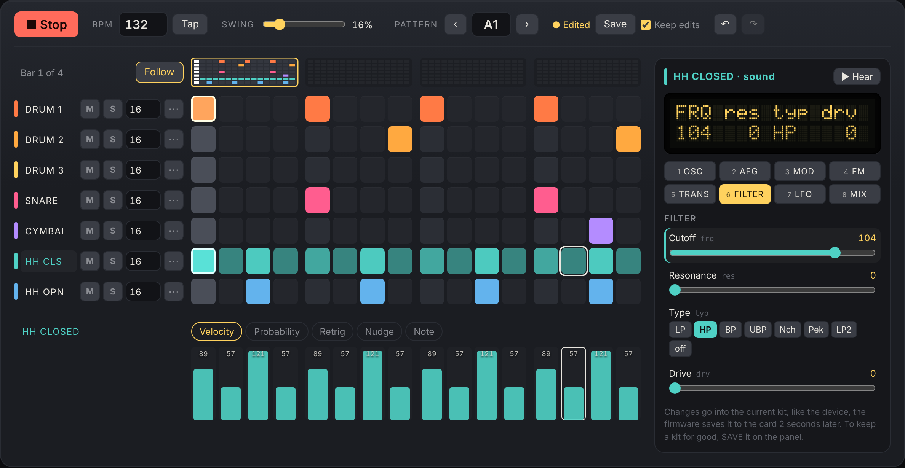

# LXR-02 Emu (unofficial) – release notes

[English](#english) · [中文](#中文)

Try it: <https://bg1eym.github.io/lxr-desktop-app/> (desktop Chrome recommended). The version is shown
at the bottom of the page.

> Not affiliated with, endorsed by or approved by Erica Synths. "Erica Synths", "LXR" and "LXR-02"
> are trademarks of Erica Synths and are used here only to say what the emulator is compatible with.

---

## English

### 0.2.1 – 2026-10-29

Fixes for the freezes reported after 0.2.0, and a reset button for sounds.

#### Fixes

- **The emulator froze after playing for a while and then pressing stop.** The sound stopped, the
  display stopped, and reloading the page could hang or crash the browser. The same bug caused the
  other freezes reported:
  - switching voices after editing for a while;
  - the first click after the page had been left alone, or after the computer slept.
- **The cause:**
  - After 2 minutes without a key or knob on the device, the firmware shows its screensaver.
  - The next key press then waits in the firmware for the screensaver's next step, up to half a
    second. On the device, time goes on during this wait.
  - In the emulator, time only moved between the firmware's main loop passes, so the wait never
    ended, and the browser's audio thread was stuck in it.
  - Playing and editing on the page don't count as keys for the firmware. So this happened after 2
    minutes of playing, or of editing on the page only.
- **The fix:**
  - Time now goes on during such waits, as on the device. Sound and sequencer keep running.
  - The key takes effect when the wait is over. Right after the screensaver this takes up to half a
    second, as on the device.
  - The 0.2.0 notes put the freeze after idle down to a timing problem in the browser. It was this
    bug. The safeguards added in 0.2.0 (the watchdog and the error messages) stay.
- **A reboot while playing lost the latest pattern edits, so it was silent after the reboot.** The
  firmware saves the pattern only once the sequencer stops. The current pattern and kit are now
  saved first when you:
  - reboot;
  - put the page in the background;
  - leave it until the automatic pause;
  - export the card.
- **After a reboot, removing a solo muted every track.** The page still showed the solo from before
  the reboot. A reboot now clears the solo, as it clears the device's mutes. A solo is also dropped
  when the mutes are changed elsewhere, for example on the panel.
- **Step velocity seemed to do nothing.** In the init kit, "Velocity → volume" is off and velocity
  modulates nothing, so velocity is not heard. The device does the same. The velocity lane now says
  so for the selected track, with a button that turns "Velocity → volume" on.

#### New

- **Reset sound** (↺ at the top of the sound panel) puts the selected voice back to the init sound
  of a new project, on all 8 pages. Other voices and the pattern stay as they are. It asks first.
  - **Reboot** restarts the emulator from the card.
  - **Erase SD card** starts again from an empty card.

#### Upgrading

Reload the page (⌘⇧R if the old one still shows). The bottom of the page should say "Version
0.2.1". The virtual SD card is kept.

### 0.2.0 – 2026-10-29

A sequencer and a sound editor above the virtual panel, made for a desktop browser.
Both edit the firmware's own data, so the panel, the display and the SD card always see the same
pattern and kit.

#### Sequencer

- **Grid** of the 7 tracks for the playing pattern. Click a step to switch it, drag to paint along a
  track, Shift-click or right-click to select. Brightness shows velocity; small marks show
  probability, retrig, nudge and parameter locks.
- **Overview** of all 4 bars (64 steps) with each track's playhead. Click a bar to show it; **Follow**
  keeps up with the playhead.
- **Track header:**
  - click the name to hear the voice;
  - mute and solo (⌘-click solos several tracks);
  - length 1–64 per track, for polymeter;
  - the **⋯** menu: every beat (four on the floor), every 8th, offbeats, every 16th, shift left or
    right, humanize velocity, copy, paste and clear.
- **Lane** under the grid: draw velocity, probability, retrig, nudge or note for the selected track.
  Double-click resets a step.
- **Toolbar:**
  - play/stop;
  - BPM: type it, scroll it or tap it;
  - swing;
  - pattern A1–D16: while playing, the new pattern starts when the current one ends, as on the device;
  - save, undo and redo (⌘Z, ⇧⌘Z).
- **Keep edits** (on by default). On the device, switching to another pattern throws away unsaved
  changes to the playing one. With Keep edits on, they are kept and saved to the card. Switch it off
  to get the device's behaviour. **Save** (⌘S) does what SAVE does on the device.
- **Keys with the grid focused:** arrows move, Shift+arrows extend, Enter switches, Delete clears,
  ⌘C/⌘V copy and paste steps, ⌘A selects the bar.

#### Sound panel

- To the right of the grid, for the voice of the selected track.
- **Pages 1–8**: OSC, AEG, MOD, FM, TRANS, FILTER, LFO, MIX, the pages the device's select buttons
  open.
- **Every sound parameter** of the page, with the firmware's own ranges and value names. Values are
  sliders; waveforms, filter types and other short lists are buttons; longer lists and modulation
  targets are drop-down lists.
- **Display**: drawn like the device's screen, with the 3-letter parameter names over their values,
  and the full name while you change one.
- Selecting a track also selects the voice on the panel, so the device's screen and knobs work on the
  same voice. This does not happen in copy, mute or performance mode, where the voice buttons do
  something else.
- The panel follows changes made with the device's knobs or by loading a kit.
- **Show or hide** it with **Sound panel** at the right of the toolbar, or × on the panel. Without it,
  the grid takes the whole width. The browser remembers the choice.
- Changes go into the current kit, which the firmware saves to the card 2 seconds later, as on the
  device. To keep a kit in a slot, SAVE it on the panel.

#### Other changes

- **Language:** the page is in English, or in Chinese when that is the browser's first language. The
  button at the top right switches, and the choice is remembered. Buttons, menus and screen-reader
  labels are translated; device terms (BPM, swing, retrig, page names) and the firmware's own
  display texts stay as on the device.
- When an LFO's target voice changes, its target moves to the same parameter of the new voice, as the
  device's menu does.
- The version and the build are shown at the bottom of the page (for example
  "Version 0.2.0 · 933bd9f").
- **Power saving:** with nothing playing, the emulated device pauses after 10 minutes without mouse
  or keyboard input, or after 5 minutes in the background. A click or a key goes on where it was.

#### Fixes

- **The page stopped after being left alone, and reloading it then hung or crashed the browser.**
  The emulator's audio stopped working after the browser had stopped and restarted it: the display
  froze, there was no sound, and a reload hung. In testing this happened after the computer slept
  and after the automatic pause, which stopped the browser's audio too. It reproduced in Chromium
  only some of the time, so it is a timing problem in how the browser restarts audio.
  - The automatic pause no longer stops the browser's audio. Only the emulated device stops; the
    audio keeps running, silent.
  - **Recovery:** if the audio stops anyway while the page is shown (for example after the computer
    slept), the emulator starts it again by itself within about 20 seconds, rebooting from the SD
    card if needed. The status line says what happened.
  - If the firmware stops with an error, the status line shows the error and **Reboot** brings it
    back, instead of a page that just stops.
  - The scenario that failed (10 minutes idle, the automatic pause, a click, then several reloads)
    now works. A real computer going to sleep could not be tested here; please report if the page
    still stops after that.
- **Updates:** after an update, the browser could use a cached file of the old version together with
  the new page. All files of one build are now loaded together.

#### Upgrading

Nothing to do. Reload the page (⌘⇧R if the old one still shows). The virtual SD card in your browser
is kept, with the patterns and kits you made before.

#### Not there yet

- Editing parameter locks (they are shown, and the old editor could clear them; that comes back
  later).
- Saving kits from the page (use SAVE on the panel).
- MIDI, and the second output.
- BPM is not autosaved, as on the device: it comes back from the project after a reboot.
- Not yet compared with recordings of a real LXR-02. An exported card has not been tried in a real
  device yet; please report what you find.

#### For developers

- The firmware sources still have a single `#ifdef LXR_EMU`.
- New on the emulator side:
  - `emu/seq_api.c`: pattern data, keep edits, save;
  - `emu/param_api.c`: the firmware's sound menus as JSON. `lxr_cli describe` prints them.
- On the web side: `web/src/seq/` (sequencer) and `web/src/sound/` (sound panel).
- Design notes are in `docs/EMULATOR_PLAN.md` (in Chinese).

### 0.1.0 – 2026-10-28

First public version.

- The LXR-02 firmware 1.7 running in the browser (WebAssembly and AudioWorklet), bit-identical to the
  native build.
- Virtual front panel with display, pots, DATA encoder, buttons, LEDs, faders and keyboard shortcuts.
- The virtual SD card is kept in the browser.
- Import and export of the card as a folder or a .zip, to move projects to and from an LXR-02.
- English and Chinese.

---

## 中文

### 0.2.1 – 2026-10-29

修复 0.2.0 之后报告的死机问题，并新增音色的重置按钮。

#### 修复

- **播放一段时间后按停止，模拟器死机。** 声音停了，屏幕也不动了；重新载入页面时，浏览器可能卡住或崩溃。之前报告的其他死机也是这个问题：
  - 编辑一段时间后切换音色；
  - 页面放着不用，或者电脑休眠之后，第一次点击。
- **原因：**
  - 设备上 2 分钟没有按键或旋钮操作，固件就进入屏保。
  - 之后第一次按键时，固件要先等屏保走到下一步，最多半秒。真机上等待期间时间照常在走。
  - 模拟器的时间只在固件的两次主循环之间前进，所以这个等待永远结束不了，浏览器的音频线程就卡在里面。
  - 播放和在网页上编辑，对固件来说都不算按键。所以播放 2 分钟以上，或者只在网页上编辑 2 分钟以上，就会出现。
- **修复：**
  - 现在这种等待期间时间也会前进，和真机一样，声音和音序器照常运行。
  - 等待结束后按键才生效。屏保之后最多要等半秒，真机也一样。
  - 0.2.0 的说明里把"放久了会死"归因于浏览器重启音频的时序问题，这个判断不对，实际是这个 bug。0.2.0 加的保护（看门狗、错误提示）保留。
- **播放中重启，最新的 pattern 修改丢了，重启后没有声音。** 固件要等音序器停下来才存 pattern。现在下面这些情况会先存好当前的 pattern 和 kit：
  - 重启；
  - 页面切到后台；
  - 放着不用，到了自动暂停；
  - 导出 SD 卡。
- **重启后取消 solo，所有轨道都静音了。** 页面上还显示着重启前的 solo。现在重启时会清掉 solo，就像重启会清掉设备的静音一样。静音在别处被改动时（例如在面板上），solo 也会取消。
- **步进的力度好像没有作用。** init kit 里"力度 → 音量"是关着的，力度也不调制任何参数，所以听不出力度的区别，真机也是这样。现在力度 lane 会针对选中的轨道提示这一点，并提供一个按钮，直接打开"力度 → 音量"。

#### 新功能

- **重置音色**（音色面板顶部的 ↺）：把选中音色 8 个页面上的设置都恢复成新项目的初始音色。其他音色和 pattern 不变。操作前会先确认。
  - **重启**：从 SD 卡重新开机。
  - **清空 SD 卡**：从一张空卡重新开始。

#### 如何升级

刷新页面即可（如果还是旧页面，按 ⌘⇧R）。页面底部应显示"版本 0.2.1"。浏览器里的虚拟 SD 卡会保留。

### 0.2.0 – 2026-10-29

虚拟面板上方新增了音序器和音色编辑器，按桌面浏览器设计。两者都直接修改固件自己的数据，所以面板、屏幕和 SD 卡上看到的始终是同一份 pattern 和 kit。

#### 音序器

- **网格**：显示正在播放的 pattern 的 7 条轨道。
  - 点击步进开关，在一条轨道上拖动可以连续画；
  - Shift 点击或右键只选中；
  - 亮度表示力度，角上的小标记表示概率、retrig、微移和参数锁。
- **总览条**：4 个小节（64 步）一览，每条轨道各有自己的播放头。点击某个小节就显示它；打开"跟随"会自动翻到正在播放的那一小节。
- **轨道头**：
  - 点名字试听；
  - 静音和独奏（⌘ 点击可以独奏多轨）；
  - 每轨长度可设 1–64，可以做复合节奏；
  - **⋯** 菜单：每拍一下（四拍底鼓）、每个八分、反拍、每个十六分、左移或右移、随机微调力度、复制、粘贴、清空。
- **网格下方的 lane**：给选中的轨道画力度、概率、retrig、微移或音高，双击恢复默认。
- **工具栏**：
  - 播放/停止；
  - BPM：可以输入、滚轮调，或者用 Tap 按节奏点；
  - Swing；
  - Pattern A1–D16：播放中切换时，新 pattern 在当前这一段结束后才开始，和真机一样；
  - 保存、撤销、重做（⌘Z、⇧⌘Z）。
- **保留修改**（默认打开）：在真机上，切换到别的 pattern 时，正在播放的 pattern 里没保存的改动会被丢弃。打开这一项后改动会保留，并存到卡上；关掉就和真机一样。**保存**（⌘S）等于真机上的 SAVE。
- **网格获得焦点时的快捷键**：方向键移动，Shift+方向键扩选，Enter 开关，Delete 关闭，⌘C/⌘V 复制粘贴步进，⌘A 选中整个小节。

#### 音色面板

- 在网格右边，编辑选中轨道的声部。
- **第 1–8 页**：OSC、AEG、MOD、FM、TRANS、FILTER、LFO、MIX，对应真机的 8 个选择键。
- **这一页的全部音色参数**，范围和数值名称都取自固件。数值用滑条；波形、滤波类型等选项少的用按钮；选项多的和调制目标用下拉列表。
- **屏幕**：按真机屏幕的样子画，上面是参数的 3 字母名称，下面是数值；调节某个参数时显示它的全名。
- 选中轨道时，真机面板也会切到这个声部，屏幕和旋钮跟着操作同一个声部。在复制模式、静音模式和 PERF 页不会切，因为那时声部键在真机上另有用途。
- 用真机旋钮修改参数或载入 kit 时，音色面板会跟着更新。
- **显示/隐藏**：点工具栏最右边的"音色面板"，或面板右上角的 ×。隐藏后网格占满整个宽度，浏览器会记住这个选择。
- 改动写进当前的 kit，和真机一样，固件 2 秒后自动存到卡上。要存进 kit 槽位，在面板上用 SAVE。

#### 其他改动

- **语言**：浏览器的第一语言是中文时页面显示中文，其他情况显示英文。右上角的按钮可以切换，选择会被记住。按钮、菜单和读屏标签都已翻译；BPM、Swing、Retrig、页名等设备术语，以及固件屏幕上的文字，保持和真机一致。
- 改变 LFO 的目标声部时，调制目标会换成新声部上的同一个参数，和真机菜单的做法一样。
- 页面底部显示版本和构建号（例如"版本 0.2.0 · 933bd9f"）。
- **省电**：没有播放时，10 分钟没有鼠标或键盘操作，或者页面在后台放了 5 分钟，模拟的设备会暂停。点击页面或按任意键就从原处继续。

#### 修复

- **页面放一段时间不用就死掉，重新载入时浏览器卡住或崩溃。** 浏览器把音频停掉再重新启动后，模拟器的音频就不工作了：屏幕冻住、没有声音，重新载入页面会卡住。测试中，电脑休眠之后会出现，自动暂停之后也会出现（当时的自动暂停也会停掉浏览器的音频）。在 Chromium 里只是有时能复现，所以是浏览器重启音频时的时序问题。
  - 自动暂停不再停掉浏览器的音频，只让模拟的设备停住，音频照常运行（静音）。
  - **自动恢复**：如果页面显示时音频还是停了（例如电脑休眠之后），模拟器会在大约 20 秒内自己重新启动音频，必要时从 SD 卡重新开机，状态栏会说明发生了什么。
  - 固件出错停止时，状态栏会显示错误，点"重启"即可恢复，不会再停在一个没反应的页面上。
  - 原来会失败的场景（空闲 10 分钟、自动暂停、点击继续、再连续重新载入几次）现在都正常。真实的电脑休眠这里没法测试；如果休眠之后页面还会死掉，请告诉我。
- **更新**：更新之后，浏览器可能把缓存里旧版本的文件和新页面混在一起用。现在同一个构建的文件总是一起载入。

#### 如何升级

不需要做任何事。刷新页面即可（如果还是旧页面，按 ⌘⇧R）。浏览器里的虚拟 SD 卡会保留，以前做的 pattern 和 kit 都还在。

#### 还没有的功能

- 编辑参数锁：目前只显示；旧的检查器能清除参数锁，这个功能以后会加回来。
- 在网页上保存 kit：请用面板上的 SAVE。
- MIDI 和第二组输出。
- BPM 不会自动存盘，和真机一样，重启后回到工程里存的值。
- 还没有和真机 LXR-02 的录音做过对比；导出的卡也还没在真机上试过。欢迎反馈试用结果。

#### 开发者相关

- 固件源代码里仍然只有一处 `#ifdef LXR_EMU`。
- 模拟器这边的新文件：
  - `emu/seq_api.c`：pattern 数据、保留修改、保存；
  - `emu/param_api.c`：把固件的音色菜单输出成 JSON，`lxr_cli describe` 可以打印出来。
- 网页这边：`web/src/seq/`（音序器）和 `web/src/sound/`（音色面板）。
- 设计记录在 `docs/EMULATOR_PLAN.md`。

### 0.1.0 – 2026-10-28

第一个公开版本。

- LXR-02 固件 1.7 在浏览器里运行（WebAssembly + AudioWorklet），和本机版输出逐样本相同。
- 虚拟前面板：屏幕、旋钮、DATA 编码器、按键、LED、推子和键盘快捷键。
- 虚拟 SD 卡保存在浏览器里。
- 以文件夹或 .zip 导入、导出 SD 卡，可以和 LXR-02 真机互相搬运工程。
- 中英文界面。
