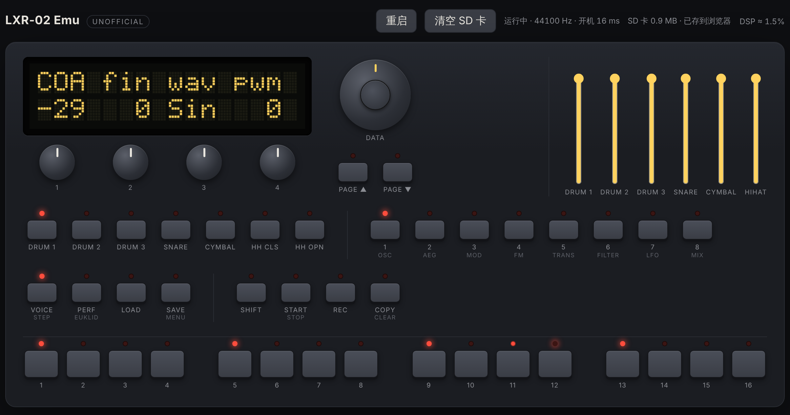

# LXR-02 Emu (unofficial)

An unofficial emulator for the **Erica Synths LXR-02** drum machine firmware.
It runs the open-source firmware's own C code (version 1.7) in the browser,
compiled to WebAssembly and played through an AudioWorklet, with a virtual
front panel.

**Try it: <https://bg1eym.github.io/lxr-desktop-app/>** (desktop Chrome recommended)

> Not affiliated with, endorsed by or approved by Erica Synths. "Erica Synths",
> "LXR" and "LXR-02" are trademarks of Erica Synths and are used here only to
> say what the emulator is compatible with.




## What it is

The sound engine, sequencer, menus and the preset/SD card code are the
firmware sources from this repository, compiled unchanged. Only the
hardware layer is replaced:

| On the device | In the emulator |
|---|---|
| STM32F765, HAL, CMSIS intrinsics (`__SSAT`, `__QADD16`, ...) | stand-in headers in `shim/`, portable C intrinsics with the same results |
| I2S DMA to two CS4344 DACs | `platform.c` renders 64-frame blocks on demand |
| TIM14 "systick" (0.25 ms), SysTick, TIM2 | driven by the number of rendered samples, at the device's exact clock ratios |
| 2x16 HD44780-style display | a model of the controller (`hw/lcd_emu.c`), drawn as a dot matrix |
| buttons and LEDs on shift registers, endless pots and faders on the ADC, data encoder | virtual pins and ADC values, decoded by the firmware's own `DIO.c`, `adcPots.c`, `encoder.c` |
| SD card | a RAM disk under the firmware's own FatFs; in the browser it is kept in IndexedDB |

There is one `#ifdef LXR_EMU` in the firmware sources (a read of address 0
that only works on the device, see `docs/EMULATOR_PLAN.md`).

### How close is the sound?

- Same code, same 16-bit integer and float arithmetic, same wavetables and samples.
- The clock runs at the device's ratios: I2S 44140.625 Hz (22.6 MHz / 512, the
  `REAL_FS` the DSP is tuned for), TIM14 3999.70 Hz, SysTick 1 kHz. The sample
  stream therefore lines up with the device; the browser plays it at 44100 Hz,
  0.09 % slower.
- Float to integer casts saturate, like VCVT on the Cortex-M7. The FM and PWM
  oscillators depend on this.
- The native build and the WebAssembly build produce bit-identical output.
- Known differences: the firmware is built with `-ffast-math` and flush-to-zero
  on the device, the emulator uses plain IEEE floats; libm functions differ;
  float to `int16_t` casts of values outside ±32767 saturate instead of wrapping.
  Not yet compared against recordings of real hardware.

## Using it

Click **Power on**. The page is in English, or in Chinese when that is your
browser's first language; the button at the top right switches.

### Sequencer

The editor at the top shows the playing pattern and edits the firmware's own
pattern data, so the panel, the display and the SD card see the same thing.

- **Grid:** click a step to switch it on or off, drag to paint along a track,
  Shift-click or right-click to select steps without switching them. Brightness
  is velocity; small marks show probability, retrig, parameter locks and nudge.
  Each track has its own length (1–64) and playhead.
- **Track header:** click the name to hear the voice, M/S to mute or solo
  (⌘-click solos several), the length box, and **⋯** for fills (every beat,
  every 8th, offbeats, every 16th), shifting, humanizing velocity, copy/paste and clear.
- **Lane:** draw velocity, probability, retrig, nudge or note for the selected
  track; double-click resets a step.
- **Inspector:** everything about the selected steps; several steps can be
  edited at once.
- **Toolbar:** play/stop, BPM (type, scroll or tap), swing, pattern A1–D16,
  save, undo/redo (⌘Z, ⇧⌘Z). The strip above the grid shows all 4 bars; click
  one to show it, or let **Follow** track the playhead.
- **Keep edits:** on the device, switching patterns throws away unsaved changes
  to the playing pattern. With **Keep edits** on (the default), the emulator
  keeps them and saves the pattern file when the pattern changes; with it off,
  it behaves like the device. **Save** (⌘S) does what SAVE does on the device.
- **Keys with the grid focused:** arrows move, Shift+arrows extend, Enter switches,
  Delete clears, ⌘C/⌘V copy and paste steps, ⌘A selects the bar.

### Panel

The virtual panel below works like the device:

- **Pots 1-4, DATA encoder:** drag up/down or use the mouse wheel. The DATA cap is the encoder's push button.
- **Buttons:** pressed while held. Click SHIFT to latch it, click again to release.
- **Faders:** voice volumes, as on the device.
- **Keyboard:** Space = START/STOP, Shift = SHIFT, ←/→ = DATA, Enter = push DATA,
  PageUp/PageDown = page buttons, 1-7 = voices, Q-I and A-K = steps 1-16, Z/X/C/V = mode buttons.

The virtual SD card is kept in the browser, so reloading the page or
**Reboot** keeps it. Like the device, the firmware writes the current kit
and pattern to the card about 2 seconds after the last change. **Erase SD card**
wipes it and the firmware formats a new one.

### Moving things to and from the LXR-02

**SD card…** copies the card's contents between the emulator and your LXR-02.
Always work with the top level of the card, the folder that holds `GLO.CFG`
and the `PROJ00`, `PROJ01`, … folders.

- **Export to folder** (Chrome, Edge): pick the mounted SD card. Files with the
  same name are replaced, other files on the card stay.
- **Download .zip**: unzip it onto the top level of the card.
- **Import from folder / .zip**: replaces the virtual card. As the firmware's
  format routine does, the card is formatted first; then the files are written
  through the firmware's FatFs and the emulator boots from the card. A zip made
  with the Finder's Compress works too (the enclosing folder, `__MACOSX` and
  `.DS_Store` are skipped).

The kit and pattern you are working on are autosaved in `/TMP`, so they travel
with the card. Export, import and export again gives byte-identical files.
Not yet tried with a real LXR-02: please report if the device doesn't load an
exported card.

Not there yet: output 2, MIDI, a sound editor, editing parameter locks.

## Building

Native command line tool (needs clang for `__fp16`):

```sh
cmake -S emu -B build/emu -DCMAKE_C_COMPILER=clang
cmake --build build/emu
build/emu/lxr_cli render --demo --out demo.wav   # 2 bars of a demo beat
ctest --test-dir build/emu                        # not silent, reproducible
```

WebAssembly and the web app (clang, lld and wasi-libc, no Emscripten; on
Ubuntu: `clang lld wasi-libc libclang-rt-18-dev-wasm32`):

```sh
cd web
npm ci
npm run wasm    # builds ../emu for wasm32-wasi into public/lxr_emu.wasm
npm run dev     # or: npm run build
```

`.github/workflows/pages.yml` does all of this on every push and deploys to GitHub Pages.

## Layout

- `emu/shim/` stand-in headers (`main.h`, `stm32f7xx_hal.h`, USB)
- `emu/hw/` GPIO, timers, SPI, RNG, display, SD card, USB-MIDI queues
- `emu/platform.c` boot sequence and main loop of `main.c`, interrupts on the sample clock
- `emu/api.c`, `emu/lxr_api.h` C API, exported to JavaScript
- `emu/cli/` command line tool
- `emu/seq_api.c` pattern data for the sequencer editor
- `web/` the page: `public/lxr-processor.js` (AudioWorklet), `src/` (panel, display, SD card storage), `src/seq/` (sequencer editor)
- `docs/EMULATOR_PLAN.md` design notes and findings (in Chinese)

## License

GPL-3.0-only, like the firmware, with the additional terms in `NOTICE.md`.
As those terms require, the emulator shows "Unofficial Emu / based on fw 1.7"
on its start-up screen. The virtual panel is a generic layout and uses no
Erica Synths artwork.

Third-party parts: FatFs (ChaN), the HD44780 character set from
[char-lcd](https://github.com/jazz-soft/char-lcd) (MIT).

Built with the help of Claude, an AI coding assistant.
